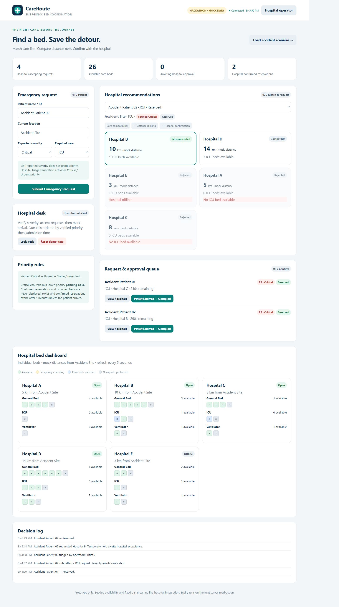

# Hospital Management & CareRoute

A Laravel application with hospital records, bed and blood inventory, and **CareRoute**, a role-based emergency bed coordination prototype. The repository also retains legacy college ERP modules and integrations.



## Features

### CareRoute emergency coordination

- Patient, hospital operator, and admin workspaces.
- Emergency submission with patient identifier, descriptive location, severity, and General/ICU/Ventilator care requirements.
- Five seeded hospitals (A–E), fixed distances, individual beds, and an offline hospital scenario.
- Hospital recommendations based on compatibility, availability, distance, and capacity.
- Operator-verified priority: Critical, Urgent, then Stable/unverified, with FIFO ties. Self-reported Critical does not elevate priority.
- Temporary bed holds, hospital acceptance into Reserved status, rejection, and arrival into Occupied status.
- Five-minute hold/reservation expiry, evaluated on server reads/actions. Occupied beds do not expire.
- Higher verified priority can reclaim lower-priority temporary holds; confirmed reservations and occupied beds are protected.
- Patient ownership checks, hospital-scoped actions, decision history, and admin reset.
- Browser polling refreshes the dashboard every five seconds.

### Existing management modules

Hospital records and logos; bed and blood type masters; bed counts and blood units; module catalogue and role assignments; user/profile management. Mail, document, report, and PDF code also remains from the legacy application. Some legacy routes reference workflows/controllers absent from this checkout.

## Technology

| Component | Implementation |
| --- | --- |
| Backend | Laravel 8 (`^8.75` declared in Composer), PHP |
| Database | MySQL/MariaDB for accounts, roles, modules, and legacy management records |
| Emergency state | JSON file with file locking to serialize updates |
| Interface | Blade views, Bootstrap assets, custom dashboard styles |
| Asset tooling | Laravel Mix 6, Sass, React 17 scaffold, Axios |
| Authentication | Laravel UI/session authentication; Sanctum dependency and protected API user route |
| Other libraries | DomPDF, Intervention Image, Guzzle |

CareRoute uses seeded data and polling. Live hospital/GPS integration, WebSocket updates, ML discharge predictions, and government reporting APIs are not implemented.

## Local setup

### Requirements

- PHP compatible with dependencies. Composer declares `^7.3|^8.0`; this checkout has run on XAMPP PHP 8.2.
- Composer, or the supplied `vendor.zip` for this snapshot.
- Apache and MySQL/MariaDB (XAMPP works for local Windows use).
- Node.js/npm if rebuilding frontend assets.
- The existing application database/schema.

### Dependencies and public files

From the project root:

```sh
composer install
```

For a fresh checkout using the supplied archives:

```powershell
Expand-Archive -Path .\public.zip -DestinationPath .
Expand-Archive -Path .\vendor.zip -DestinationPath .
```

Both archives contain their own top-level folder. Confirm `public/index.php` and `vendor/autoload.php` exist without extra nesting. Avoid overwriting an installed instance's assets/dependencies.

The current Git configuration ignores `public/`, `vendor/`, and `composer.lock`. A checkout may lack public files, and dependency versions are not pinned by a committed lockfile.

### Environment and database

Preserve an installed instance's `.env`. For a fresh environment, create `.env`; this checkout has no `.env.example`. A minimal local configuration is:

```dotenv
APP_NAME=CareRoute
APP_ENV=local
APP_KEY=
APP_DEBUG=true
APP_URL=http://localhost/Hospital/public
DB_CONNECTION=mysql
DB_HOST=127.0.0.1
DB_PORT=3306
DB_DATABASE=your_existing_database
DB_USERNAME=root
DB_PASSWORD=
SESSION_DRIVER=file
CACHE_DRIVER=file
QUEUE_CONNECTION=sync
```

Use the actual database name, credentials, and port for your installation. Start MySQL before opening the app. Generate a key only for a new environment:

```sh
php artisan key:generate
php artisan config:clear
```

**Schema prerequisite:** committed migrations create only Laravel base tables. They do not recreate the hospital/legacy schema, and no SQL dump is included. Obtain the existing schema/data first; `migrate --seed` alone cannot set up this application.

### Demo accounts

After restoring the existing schema:

```sh
php artisan db:seed --class=CareRouteDemoSeeder
```

The seeder requires extended user columns and legacy tables including `role_mast`, `modules`, and `module_assigning`. It assumes college ID `1`, Admin role `2`, and Super Admin role `1`. It creates missing accounts and adds module assignments; existing account passwords are preserved on reruns.

New demo accounts use password **`CareRoute@2026`**:

| Email | Role | Workspace |
| --- | --- | --- |
| `admin@careroute.test` | Admin | Management summary, masters, inventory, assignments and users |
| `hospital.c@careroute.test` | Hospital C operator | New-request triage, C reservations and bed state, arrival |
| `hospital.b@careroute.test` | Hospital B operator | New-request triage, B reservations and bed state, arrival |
| `patient@careroute.test` | Patient/requester | Submit emergencies, request beds, track own requests |

### Start the app

Start Apache and MySQL in XAMPP, then open [Login](http://localhost/Hospital/public/login) or [Emergency workspace](http://localhost/Hospital/public/emergency).

Alternatively:

```sh
php artisan serve
```

Use the address Artisan prints, normally `http://127.0.0.1:8000/login`. For an Apache virtual host, point its document root at `public/`. Ensure `storage/` and `bootstrap/cache/` are writable.

### Build assets when needed

```sh
npm install
npm run dev
```

Use `npm run watch` during development or `npm run prod` for a production build. Mix compiles the React scaffold and Sass; the emergency dashboard is a Blade view with inline JavaScript.

## Demo walkthrough

Use separate browser profiles/private sessions for simultaneous roles; tabs in one browser profile share authentication.

1. Admin manages masters, inventory and account assignments; use a prepared demo dataset for the care workflow.
2. Patient submits Critical / ICU / Accident Site and requests Hospital C.
3. Hospital C verifies severity and accepts the request into Reserved status.
4. Patient submits a second ICU request. Hospital B is recommended because C's confirmed reservation is protected.
5. Hospital B verifies and accepts the second request.
6. Hospital C marks the first patient arrived, changing the bed to Occupied.

See [the complete login walkthrough](DEMO-LOGIN-FLOW.md) and [the presentation guide](HACKATHON-DEMO.md). If an older guide names a different database, follow your installation's `.env` configuration.

## Routes

Paths are relative to the application base URL.

| Method | Path | Purpose |
| --- | --- | --- |
| GET | `/login` | Login screen |
| GET | `/`, `/emergency` | Role-based emergency workspace |
| GET | `/emergency/requests` | Emergency form and hospital recommendations: patient only |
| GET | `/emergency/approvals` | Verify, accept, reject, and record arrival: hospital operator only |
| GET | `/emergency/beds` | Individual bed availability: hospital operator only |
| GET | `/emergency/inventory` | Own hospital bed capacity and patient discharge |
| GET | `/emergency/blood` | Own hospital blood stock by group |
| GET | `/emergency/settings` | Own hospital contact, address and Open/Offline status |
| POST | `/emergency/manage` | Validated hospital management updates; hospital identity comes from login |
| Resource routes | `/emergency/inventory`, `/emergency/blood` | Hospital-scoped lists, Add/Edit forms, POST create, PUT update and DELETE remove |
| GET | `/emergency/reservations` | Reservation status: patient only |
| GET | `/emergency/history` | Decision history scoped to the signed-in role |
| GET | `/emergency/state` | JSON state filtered for the signed-in demo account |
| POST | `/emergency/action` | Emergency actions with session authentication and CSRF protection |
| GET | `/demo/modules`, `/demo/users` | Admin demo guides |
| Resource routes | `/Hospital`, `/Bedtype`, `/BloodType` | Management masters |
| Resource routes | `/BedInven`, `/BloodInven` | Inventory management |
| Resource routes | `/ModuleMaster`, `/ModuleAssigning`, `/NewUser` | Legacy administration |
| GET | `/api/user` | User response protected by `auth:sanctum` |

Emergency actions are `create`, `verify`, `request`, `accept`, `reject`, `arrive`, and admin-only `reset`. The old `login`/`logout` action values are rejected; use the account controls.

The dashboard contains summaries and links, with each data category on its own page. Page URLs and JSON responses enforce assigned-module access. Patients see only their own requests/history and recommendations; operators see their own hospital's beds and assigned requests, plus new requests awaiting triage. Admins manage masters, inventories, users and assignments; they cannot access emergency requests, approvals, reservations, individual emergency beds or decision history. Masters, inventories, and user/module administration remain separate administration pages. The state endpoint accepts `?page=requests`, `approvals`, `beds`, `reservations`, or `history`; its default dashboard response contains counts rather than detail records.

`routes/api.php` also contains legacy login, OTP, and password-update endpoints with external ERP integration. These are separate from CareRoute. Blood donation and bed prediction APIs described in the former README are not present.

## Architecture and data

| Location | Responsibility |
| --- | --- |
| `app/Http/Controllers/` | Authentication, emergency actions, management, legacy workflows |
| `app/Http/Middleware/` | Demo role access and legacy module checks |
| `app/Models/` | MySQL-backed management/ERP models |
| `app/Services/EmergencyBedService.php` | Matching, priority, holds, reservations, expiry |
| `app/Support/DemoAccess.php` | Demo profiles and menu filtering |
| `config/demo.php` | Demo account profiles and module definitions |
| `config/emergency.php` | Store path and reservation expiry |
| `database/seeders/CareRouteDemoSeeder.php` | Accounts, roles, module assignments |
| `resources/views/` | Blade login, emergency, and management screens |
| `routes/` | Web and legacy API routes |
| `storage/app/emergency-demo.json` | Emergency mock state, initialized on first use |
| `tests/` | Domain checks, HTTP role flow, PHPUnit examples |

MySQL hospital/inventory records and emergency A–E JSON data are separate. Editing legacy inventory does not change emergency capacity. Admin reset changes only emergency JSON state, preserving accounts and MySQL management data. Locations are descriptive; distances are seeded values.

Hospital operators use their own Bed Inventory, Blood Inventory and Hospital Settings pages in the emergency workspace. These persist in the hospital's A–E JSON record. Bed capacity changes update emergency matching immediately and cannot remove held, reserved or occupied beds. Discharge releases an occupied bed and marks its linked request Discharged. Offline status excludes new recommendations while preserving existing allocations. Blood stock is separate from legacy MySQL blood inventory and is not a donation/expiry tracking system. Admin and patient accounts cannot access these hospital management pages.

Bed and blood inventory use the same list/Add/Edit/Delete page pattern as the legacy masters. Each bed record has a name, care type and allocation status. Bed creation starts Available; only Available beds can be edited/deleted. Blood inventory stores one record per group per hospital, with duplicate groups rejected. Hospital settings edit the existing assigned hospital; hospital operators do not create/delete hospital master records.

## Verification

Isolated emergency domain checks:

```sh
php tests/emergency-smoke.php
```

HTTP role workflow, against a running app with seeded accounts (PowerShell 7):

```powershell
pwsh -File .\tests\demo-role-flow.ps1 -BaseUrl http://localhost/Hospital/public
```

The HTTP workflow script creates test requests and requires a prepared disposable demo instance with capacity available. It verifies that admins cannot reset care data. `php artisan test` runs the PHPUnit suite, which currently contains starter examples rather than comprehensive application coverage.

For read-only page/data permission checks (no reset):

```powershell
pwsh -File .\tests\demo-page-access.ps1 -BaseUrl http://localhost/Hospital/public
```

## Troubleshooting and prototype limits

- Missing `public/index.php`: restore `public.zip` into the root and check folder nesting.
- Missing autoloader: install Composer dependencies or restore `vendor.zip`.
- Database connection refused: start MySQL, check `DB_HOST`/`DB_PORT`, then run `php artisan config:clear`.
- Missing table/column: restore the existing schema; base migrations are insufficient.
- Demo login failure: seed after schema restoration; rerunning does not change existing passwords.
- Legacy page failure: some retained routes depend on missing controllers or ERP data.

This is a seeded coordination prototype. Legacy password-reset endpoints, uploads, validation, and authorization need further review before deployment. Published demo passwords belong in demo environments. Configure mail separately for legacy email/OTP flows, and disable debug output outside local development.

## License

The repository's [LICENSE](LICENSE) contains the Apache License, Version 2.0.
