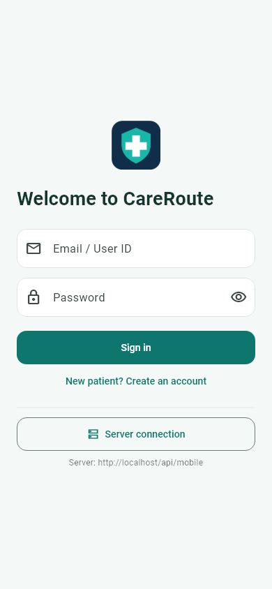
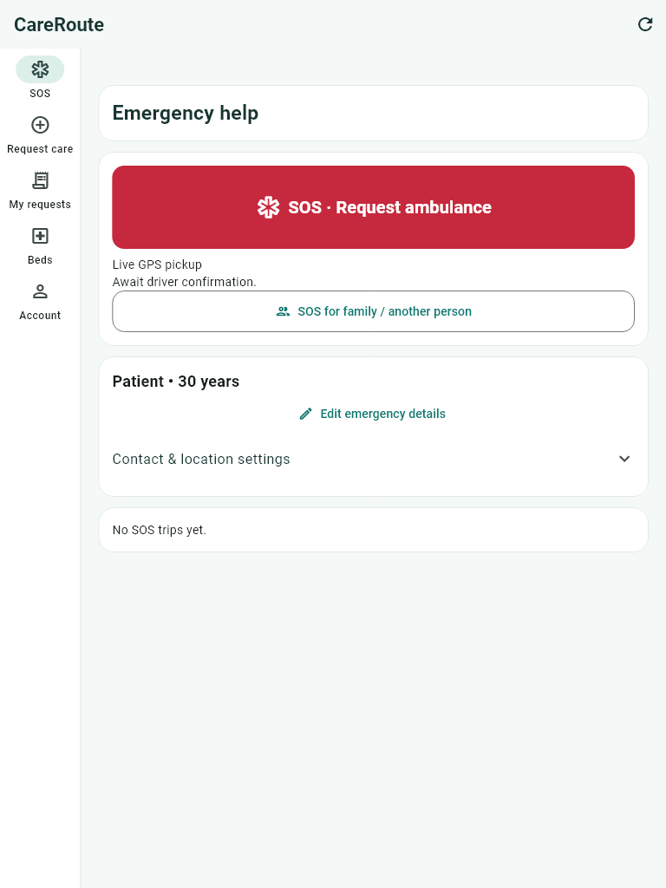

# Hospital & CareRoute

A shared care platform for hospitals, patients and ambulance drivers. The **web portal** manages resources and approvals; the **Android app** handles care requests, SOS and pickup tracking. Both use the same database.

[Open web portal](http://localhost/Hospital/public/login) · [Download Android APK](deliverables/Hospital-Test.apk) · [Test accounts](docs/TEST-ACCOUNTS.md) · [Setup guide](docs/SETUP.md)

## What's new

**Version 1.7.0 — automatic SOS capture.** Tap SOS to automatically capture a front-camera photo and record 10 seconds of audio. There is no shutter or media confirmation. Drivers can view the photo and play the recording; both stay privately stored with the SOS. [SOS photo flow and testing](docs/SOS-PHOTO.md).

The simpler interface remains: Soft teal and white screens, shorter guidance, readable cards and forms, and layouts that adapt to phones, tablets and larger displays. Android uses bottom navigation on phones and a side rail on taller wide screens. Web tables scroll within their own containers.

This release changes only SOS media capture, private voice storage and authorized playback. Login, ordinary ambulance/bed booking and role permissions are preserved. It uses the existing trip table and needs no migration or password reset.

History and dashboard previews show **two recent entries** first, with **View all / View less** for the rest of the available records. Active requests and trips remain visible. Extra contact, GPS, insurance and bed details open on tap; the main screens focus on status and actions.

| Phone login | Tablet navigation |
| --- | --- |
|  |  |

[View the UI changes and screen-size checks](docs/UI-REFRESH.md)

## Choose your workspace

| Workspace | What you can do |
| --- | --- |
| Admin | Manage hospitals, departments, ambulances, accounts, masters and module permissions |
| Hospital | Manage its own beds and blood stock; review requests, coverage and patient arrivals |
| Patient | Request care, choose a hospital or ambulance, track bookings and manage family/insurance |
| Driver | Manage availability, accept pickups, track transport and complete hospital handoff |

Menus follow the modules assigned by the admin. Each role sees the records and actions it is permitted to access.

## Web portal

1. Start **Apache** and **MySQL** in XAMPP.
2. Open [the login page](http://localhost/Hospital/public/login).
3. Sign in with your existing account or a [test account](docs/TEST-ACCOUNTS.md).

For a new installation, follow [database, dependencies and migration setup](docs/SETUP.md). The existing populated database is `colleges`. Keep the existing application key; do not recreate the database to install this update.

## Android app

[**Download CareRoute 1.7.0**](deliverables/Hospital-Test.apk) — Android 7.0 or later; ARM32, ARM64 and x86_64. This is a debug-signed local test APK.

1. Install the APK and keep your phone and backend PC on the same Wi-Fi.
2. Open **Server connection → Current test server → Test & save** if the app remembers an older address.
3. Sign in using the same account as the web portal.

| Device | API address |
| --- | --- |
| Phone | `http://10.9.6.195/Hospital/public/api/mobile` |
| Android emulator | `http://10.0.2.2/Hospital/public/api/mobile` |

The phone address is the PC's address used for this build. If the PC's IP changes, update **Server connection**. Credentials are stored on the backend; the APK contains no database password.

[APK details and checksum](deliverables/README.md) · [Flutter development](mobile/careroute/README.md)

## Care and booking

| Problem type | First option | Also available |
| --- | --- | --- |
| Internal | Nearest idle ambulance and estimated arrival | Hospital bed booking |
| External | Nearby hospital with the required service and an available bed | Ambulance pickup |

Ambulance bookings reach the selected driver; hospital bookings reach the selected hospital. Driver confirmation and hospital acceptance still apply. GPS is shared in the foreground; distance and arrival time are estimates.

Family profiles, insurance policies and panel memberships live under **Account → Family & insurance**. SOS can be raised for yourself, a family member or another person. Coverage verification and cashless decisions remain separate from bed approval.

[Booking demonstration](docs/CARE-BOOKING-DEMO.md) · [Insurance and family SOS](docs/INSURANCE-FAMILY-SOS.md)

## Local test accounts

All five dedicated test accounts use **`TestCare@2026`**. Existing accounts and passwords are preserved.

| Role | User ID |
| --- | --- |
| Patient | `patient.test@careroute.test` |
| Hospital | `hospital.test@careroute.test` |
| Driver 1 | `driver1.test@careroute.test` |
| Driver 2 | `driver2.test@careroute.test` |
| Admin | `admin.test@careroute.test` |

## Checks and troubleshooting

Run from the project folder:

```powershell
C:\xampp\php\php.exe tests/login-http-smoke.php
C:\xampp\php\php.exe tests/shared-database-api-smoke.php
```

The API login check removes only its own tokens. Workflow checks roll back test changes. Android UI tests include small phones, landscape, tablets, desktop widths and enlarged text; see [UI verification](docs/UI-REFRESH.md).

| Issue | Quick check |
| --- | --- |
| App cannot connect | Check the PC's current IP, same Wi-Fi and running Apache/MySQL |
| Missing module or 403 | Check admin-assigned permissions and hospital/ambulance assignment |
| 419 on web form | Refresh the page and sign in again |
| No ambulance listed | Drivers must be on duty, idle and sharing fresh real GPS |
| No hospital shown | The hospital must accept requests and offer the required service and bed |

After changing `.env`, refresh its cache with `C:\xampp\php\php.exe artisan config:cache`. This release does not require a migration or seeder.

## Project reference

- [Setup and sample data](docs/SETUP.md)
- [Shared database and architecture](docs/WEB-APP-DATABASE.md)
- [Test accounts](docs/TEST-ACCOUNTS.md)
- [Booking demo](docs/CARE-BOOKING-DEMO.md)
- [Insurance, panels and SOS](docs/INSURANCE-FAMILY-SOS.md)
- [Automatic SOS photo and voice](docs/SOS-PHOTO.md)

The app uses foreground GPS and in-app updates. Background push, road-routing ETAs and live insurer/emergency-provider integrations are not implemented. Physical phone installation and GPS/photo-picker testing remain part of device testing.
