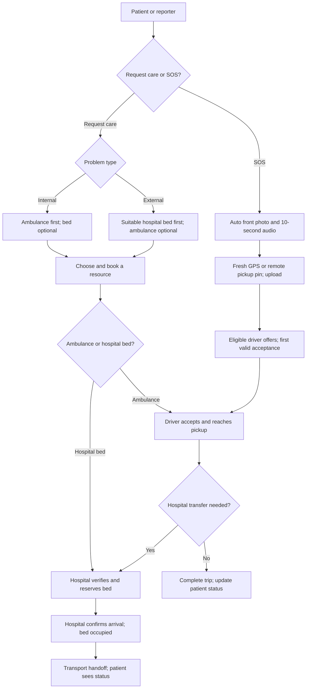

# CareRoute: system flow and jury pitch

**Current demonstration: Android 1.7.0 and the shared hospital web portal.**

CareRoute connects patients, available ambulances and suitable hospitals. Resource availability, booking confirmation and transport status share one system.

[Project overview](../README.md) · [Setup](SETUP.md) · [Demo accounts](TEST-ACCOUNTS.md) · [Shared database](WEB-APP-DATABASE.md) · [Automatic SOS capture](SOS-PHOTO.md)

## Who manages what?

| Role | Responsibility and visibility |
| --- | --- |
| Admin | Maintains accounts, hospitals, services, ambulance categories/details and insurance/panel masters. Assigns menu modules and permissions. |
| Hospital | Manages own beds, blood stock and accepting status. Verifies severity, approves beds, confirms arrival and reviews related coverage. |
| Patient / reporter | Books and tracks owned requests; manages family/coverage; raises SOS for self, family or another person. |
| Ambulance driver | Shares duty/location, sees eligible offers/selected bookings, confirms pickups, updates transport and completes handoff. |

Menus follow assigned modules; access checks restrict hospitals to their bookings, patients to owned requests and drivers to permitted offers/trips.

## The patient-to-hospital journey

### Request care

1. Select **Internal/External**, describe the problem, choose the required service and care/bed type, and share location. Family and suitable coverage are optional.
2. **Internal** covers illnesses/problems such as heart attack or appendix-related pain: nearby idle **ambulance first**, with registered vehicle/driver/doctor details and estimated arrival; bed optional.
3. **External** covers injuries such as accidents: suitable **hospital bed first**; ambulance optional.
4. Hospital choices check service, accepting status and compatible capacity. Distance ranks suitable options; a compatible hospital preference can take priority. A hospital lacking the required service cannot receive that booking.
5. Ambulances require an on-duty, idle driver with fresh live GPS. Selection reserves a vehicle pending confirmation; only that driver receives the booking.
6. A bed request creates a temporary hold at the selected hospital. Severity verification and acceptance confirm the reservation; arrival marks it occupied. Rejection, cancellation or expiry releases eligible holds. Booking rechecks availability.
7. Patient/driver track transport updates. Transfer reuses a linked care request. Hospital arrival confirmation precedes driver handoff; trip completion releases the ambulance. Hospital discharge releases the occupied bed.

Internal/External is a workflow category, **not a clinical diagnosis**. Staff make medical decisions.

### Direct SOS

1. Complete the existing emergency profile/recipient details, then tap SOS. Self, Family and Other are supported; another patient's identity may be unknown.
2. Android automatically captures the **reporter's front-camera photo** and **10 seconds of audio**; both are mandatory. No shutter/media confirmation is needed. First-use permissions still require Android consent.
3. The app refreshes GPS and uploads both attachments. A remote patient's supplied manual pickup pin remains unchanged.
4. The backend validates/stores media privately and offers the trip to eligible nearby drivers. The first valid acceptance wins under a shared database lock; an offer alone is unconfirmed.
5. Offered/assigned drivers see the photo and audio; the assigned driver receives contact details. Media remains in trip history. Unrelated patients/hospitals and drivers with withdrawn offers cannot access it.
6. Pickup, first-aid recording where applicable, hospital selection, acceptance, arrival and handoff follow the existing workflow.

Capture, permission, location or upload failure creates no new SOS. Dispatch starts **after** capture/location. Media provides context, not identity verification or clinical assessment.

## Insurance and panel patients

Patients maintain coverage and private cards for themselves/eligible dependents. Hospital mappings cover insurance, TPA, employer and scheme arrangements. Labels preserve suitable non-panel choices.

Hospital verification/cashless review is separate from bed approval. Insurance is optional for SOS; unrelated patients cannot use the reporter's policy. Review is manual; live authorisation, claims and payment integration are absent.

## One database, two interfaces

Laravel web/API and Flutter Android share MySQL users, masters, capacity, requests and trips. The APK calls authenticated APIs, without database credentials. Masters/inventories use CRUD screens and controllers. Private SOS media has server storage, database associations and authenticated access.

## Spoken pitch: 60–90 seconds

> CareRoute helps connect a person needing care with an available ambulance and a suitable hospital. Our web portal lets hospitals maintain capacity and confirm admissions, while our Android app lets patients request help and drivers manage pickups. Both use one shared database.
>
> For an Internal problem, the app offers an available ambulance first, with a hospital bed as another option. For an External injury, it offers a hospital with the required service and bed capacity first, with ambulance pickup available alongside it.
>
> Direct SOS automatically captures the sender's front-camera photo and ten seconds of audio before submitting the location and request. Eligible drivers receive offers, and the first confirmed acceptance owns the trip. The patient can follow its status, while the hospital receives its own admission request and confirms arrival.
>
> Family reporting and insurance records support the same journey. Our demonstration shows resource coordination and confirmation; medical decisions stay with staff. The next stage is physical-device validation and integrations for background alerts, road routing and insurer systems.

## Jury demo: 5–7 minutes

Prepare XAMPP, matching APK/backend, patient/driver phones and a hospital browser. Use [test accounts](TEST-ACCOUNTS.md), update the server IP, check compatible beds/services and keep apps open. Request Care requires driver GPS. Use consented media/test contacts.

| Time | Show |
| --- | --- |
| 0:00–0:45 | Explain the problem; show admin-managed services/ambulances and role-specific screens. |
| 0:45–2:00 | Internal request: ambulance chooser, idle vehicle, estimate, selected-driver confirmation. Cancel/finish the trip and close its care request before the next case. |
| 2:00–3:30 | External request: compatible hospital, bed request, severity verification and acceptance. Confirm arrival/discharge to close this case before SOS. |
| 3:30–4:45 | SOS: automatic photo/audio, driver offer, playback and acceptance. Allow first-use permissions beforehand for a smooth demonstration. |
| 4:45–6:00 | Transport status, linked hospital request, confirmed arrival and driver handoff. |
| 6:00–7:00 | Family/coverage record and separate hospital review; explain current limits. |

Rehearse physical camera/microphone capture first. Label simulations clearly and report capture failures honestly.

## Common jury questions

**Is the nearest resource always suitable?** Hospital service/capacity and driver eligibility matter before distance. The backend rechecks availability; estimates are not road-routing guarantees.

**Can two drivers accept one SOS?** The shared transaction lock makes the first valid acceptance the assigned trip; later conflicting acceptance is rejected.

**Does the admin approve emergencies?** Hospital staff approve their own admission requests; drivers confirm their pickups. The admin maintains resources and access.

**What has been validated?** Automated app/server checks and APK compilation/signing. Physical camera/microphone/GPS validation remains pending; use the [capture guide](SOS-PHOTO.md).

**What comes next?** Background push, road-route ETAs, live insurer/TPA integration and broader operational/device validation are roadmap items. The current local test build needs network access and foreground apps; it is not a production dispatch service.
