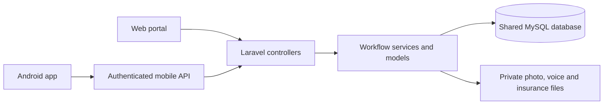

# Shared database and MVC architecture

CareRoute 1.7.0 uses Laravel 8/PHP and the existing MySQL `colleges` database at `localhost:3306`. The web portal and Flutter Android app share accounts, requests, hospital inventory and ambulance trips. Android calls `/api/mobile`; it contains no database credentials and does not connect directly to MySQL.

## Request path

Web authentication uses sessions and CSRF protection. Mobile authentication uses scoped Sanctum bearer tokens, disabled-account checks and seven-day expiry. Both authenticate the same `users` rows and hashed passwords. Runtime menus read `modules` and `module_assigning`; catalogue/seed configuration does not replace these assignments.

## Code responsibilities

| Layer | Main locations | Responsibility |
| --- | --- | --- |
| Controllers | `app/Http/Controllers`, `routes/web.php`, `routes/api.php` | Authentication, validation, CRUD and web/API responses |
| Services | `EmergencyBedService`, `AmbulanceService`, `AmbulanceDispatchStore` | Matching, ownership, reservation and dispatch transitions |
| Coverage/media services | `PatientCoverageService`, `SosRecipientService`, `SosReporterPhotoService`, `SosReporterVoiceService` | Eligibility, reporter identity and private attachments |
| Models | `app/Models` | Existing masters and workflow relationships |
| Web views | `resources/views` | Role pages and shared CRUD forms |
| Android client | `mobile/careroute/lib` | API/session state, responsive screens and request/trip views |
| Android capture | `MainActivity.kt`, `SosCaptureActivity.kt` | Foreground automatic front photo, 10-second audio and playback |

## Shared data and access

| Area | SQL tables | Responsibility |
| --- | --- | --- |
| Accounts/modules | `users`, `role_mast`, `modules`, `module_assigning` | Admin assigns enabled accounts and modules |
| Hospital masters | `hospital_mast`, `department_mast`, `hospital_department_mapping`, `bedding_type`, `blood_type` | Assigned master CRUD |
| Hospital operations | `care_beds`, `care_requests`, `care_events`, legacy `blodd_inventory_management` | Patient-owned requests; assigned-hospital capacity and decisions |
| Ambulances/drivers | `ambulance_category_mast`, `ambulance_details`, `ambulance_drivers` | Vehicle/staff/ownership masters and one assigned ambulance per driver |
| Profiles/trips | `patient_emergency_profiles`, `ambulance_trips` | Sender owns SOS; drivers see offered/assigned trips |
| Coverage/panels | `coverage_organisations`, `hospital_coverage_mapping`, `patient_dependents`, `patient_coverages` | Admin/hospital mappings and owner-scoped family/coverage records |
| Mobile tokens | `personal_access_tokens` | Scoped authenticated API access |

## Booking and concurrency

Request Care stores Internal/External problem type, assistance preference, department, description, preferred hospital and timestamped pickup coordinates. Internal shows ambulance selection first; External shows compatible hospital beds first. These are assistance preferences, not an automated diagnosis.

Selected ambulance booking reserves the chosen idle driver under the SQL dispatch lock while confirmation is pending. Direct SOS broadcasts to eligible nearby drivers; first acceptance wins under the same lock. A busy driver cannot accept a second active trip. The default dispatch store is SQL; the JSON adapter remains only for explicitly supplied isolated test paths.

Trips link to care requests through `care_request_id` in the existing trip payload. Hospital transfer reuses that request where applicable. Hospital verification/acceptance is required for the bed; arrival must be confirmed before driver handoff completes. Hospital workflow mutations also use a shared SQL lock to protect holds and occupied beds. The operational journey is in [System flow & jury pitch](SYSTEM-FLOW-AND-PITCH.md).

## Private files

SOS photo/voice metadata is associated with `ambulance_trips.payload`; binary attachments stay on the private local disk, outside `public/storage`. Photos use `storage/app/sos-reporter-photos` and recordings use `storage/app/sos-reporter-voices`. Owner/admin and current offered/assigned drivers can retrieve them through authenticated endpoints. Active-SOS retries preserve the originals; failed saves remove new files.

Insurance cards require owner or related booked-hospital access. Drivers cannot view policy details/cards. Coverage verification and cashless decisions remain independent from bed status. See [SOS media](SOS-PHOTO.md) and [Insurance & family](INSURANCE-FAMILY-SOS.md). Back up the private attachment folders alongside the database.

## Setup and verification

Use [SETUP.md](SETUP.md) for the complete additive migration list and optional sample data. Use [TEST-ACCOUNTS.md](TEST-ACCOUNTS.md) for the current credentials. Do not apply legacy reset/demo instructions from earlier prototype releases.

The APK's bundled phone endpoint is `http://10.9.6.195/Hospital/public/api/mobile`; change Server connection when the PC's Wi-Fi address changes. The Android emulator uses `10.0.2.2`. Check `/api/mobile/health`; the current backend returns `service: CareRoute`, `storage: mysql` and `mock_data: false`.

After a deliberate `.env` change, refresh configuration with `C:\xampp\php\php.exe artisan config:cache`. Preserve the existing application key and database. The local APK allows HTTP for testing; production release configuration requires HTTPS.

The 1.7.0 release passed 52 Flutter tests, 64 voice checks, 60 photo checks, 30 SOS API checks, 50 shared SQL checks and 44 insurance/family checks. `tests/login-http-smoke.php` checks all five real API logins and revokes only its issued tokens. SQL workflow tests use isolated data or roll back their changes. Automatic capture still needs physical phone verification; foreground GPS/status updates are implemented, background push and external insurer integrations are not.
